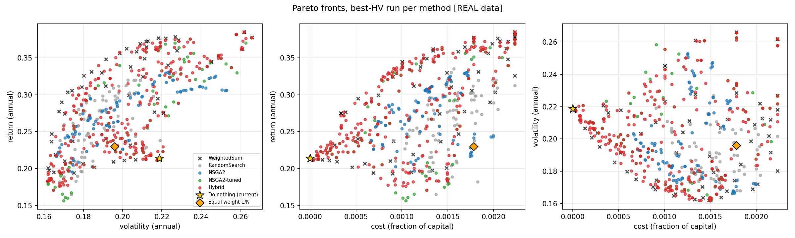
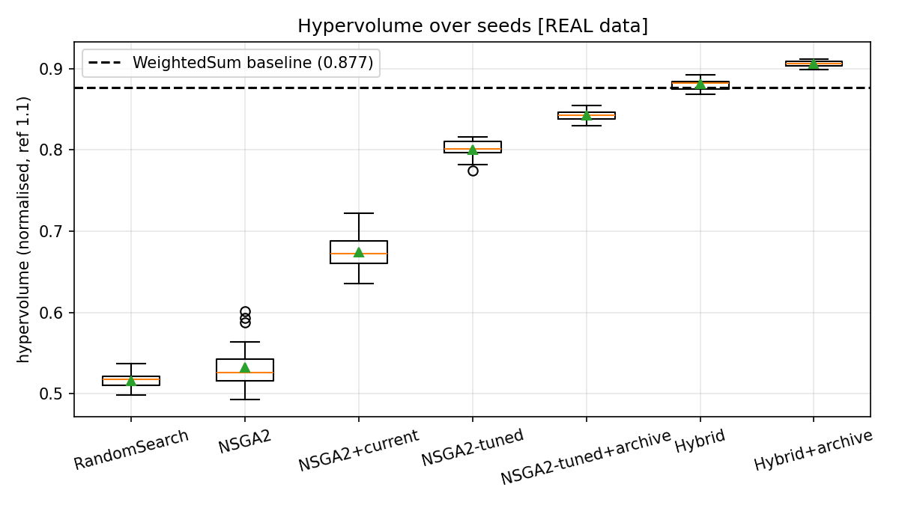
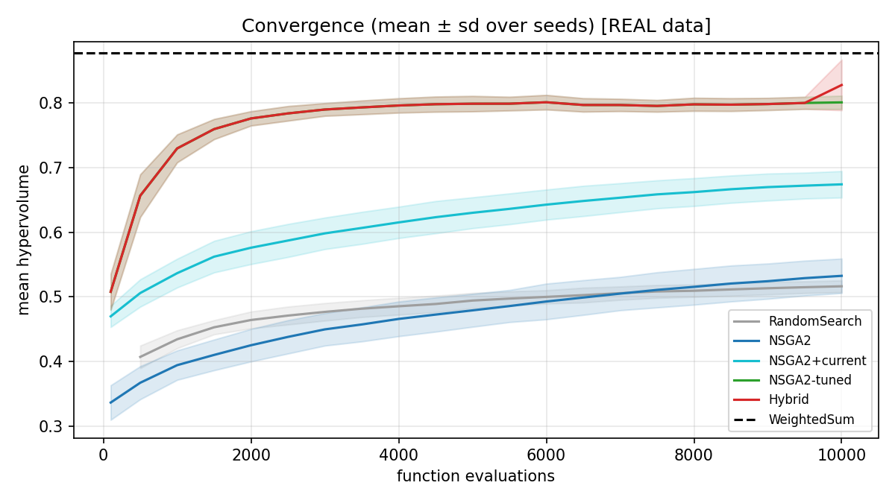
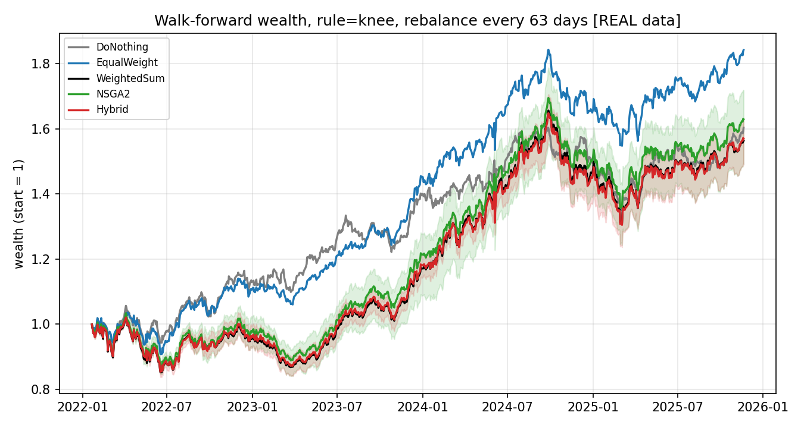

# PortfolioPilot: Multi-Objective Portfolio Rebalancing under Return, Risk and Transaction-Cost Constraints

An investor already holds a portfolio of Indian (NSE) stocks and must decide how to rebalance it. PortfolioPilot finds the set of best trade-offs between expected return, risk (volatility) and one-off trading cost, under practical limits on position size, sector exposure and number of holdings, and lets the investor inspect and choose one.

## 1. Group Details

| Member | Roll No. | GitHub/GitLab Username |
|--------|----------|------------------------|
| Akhil | 241070004 | akhil-gitcoder |
| Ridhima | 241071062 | ridhima-07 |

- Course: Optimization Techniques
- Professor: Akhil Kulal
- Approved topic: PortfolioPilot: Multi-Objective Portfolio Allocation and Rebalancing under Return, Risk and Transaction-Cost Constraints
- Group size: 2 members (approved by the professor)

## 2. Problem Statement

A retail or institutional investor holds a concentrated portfolio of NSE stocks (the current portfolio). Rebalancing means choosing new weights, and the goals conflict: moving toward higher expected return usually raises volatility, and every trade costs money (brokerage, taxes and charges, modelled here as proportional rates), so "do nothing" is cheap but may be far from the best trade-off. Real rules also apply: a limit per stock and per sector, a maximum number of holdings, and a minimum meaningful position size. The decision-maker needs the set of non-dominated rebalancing options with their trade-offs, not a single number, which is why multi-objective optimization is required.

## 3. Formulation Summary

- **Decision variables:** portfolio weights $x \in \mathbb{R}^{30}$, one per stock, $x_i \ge 0$, $\sum_i x_i = 1$ (30 NSE stocks, 8 sectors).
- **Objectives (all minimised internally):** $f_1(x) = -\mu^\top x$ (negative expected annual return), $f_2(x) = \sqrt{x^\top \Sigma x}$ (annual volatility), $f_3(x) = \sum_i \left[ b_i \max(x_i - x^{old}_i, 0) + s_i \max(x^{old}_i - x_i, 0) \right]$ (one-off rebalancing cost as a fraction of capital). They conflict: higher return needs concentrated or riskier holdings, and any move away from the current portfolio costs money.
- **Constraints:** fully invested, long-only, at most 20% in one stock, at most 40% in one sector, at most 10 holdings, at least 3% in any stock held.
- **Problem type:** multi-objective (3 objectives), nonlinear (quadratic risk, piecewise-linear cost), mixed continuous-combinatorial and non-convex because of the holdings limit and minimum position size; deterministic given the estimated $\mu, \Sigma$. Without the holdings limit and minimum position it is convex (used for validation).

The full mathematical formulation is in `formulation/formulation.md`.

## 4. Methods Implemented

| Method | Purpose | Location |
|--------|---------|----------|
| Random search | Baseline 1: same decoder and budget as NSGA-II | `src/baseline/random_search.py` |
| Weighted-sum relax-and-round (CVXPY) | Baseline 2, the one to beat: convex relaxation per weight vector, round to 10 stocks, polish | `src/baseline/weighted_sum_relax_round.py` |
| NSGA-II (written from scratch) | Main multi-objective algorithm with random-key encoding and constraint repair | `src/algorithms/nsga2.py` |
| NSGA-II improvements | Inject current portfolio, sparse initial supports, support-reset mutation, external archive | `src/algorithms/nsga2.py` |
| Hybrid (NSGA-II + convex polish) | NSGA-II chooses the stocks, a convex solve sets exact weights | `src/hybrid/polish.py` |
| Exact front (convex model) | Correctness check only, not a competitor | `src/reference/exact_front.py` |
| Walk-forward test | Out-of-sample evaluation over 15 quarters | `src/walk_forward.py`, `experiments/run_walkforward.py` |

Libraries used (cited, with configuration): NumPy, SciPy, pandas, scikit-learn (`LedoitWolf` covariance), CVXPY with the CLARABEL solver, yfinance (data download only), matplotlib, pytest. NSGA-II, the metrics, the repair step and the archive are our own code; no multi-objective library is used.

## 5. Repository Structure

```
PortfolioPilot/
├── README.md                  this file
├── main.py                    entry point (data, experiment, walkforward, figures, inspect)
├── requirements.txt
├── config/                    default.json (all parameters), universe.csv (30 stocks, sectors)
├── data/                      DATA.md, prices_real.csv (real snapshot), synthetic_prices.csv
├── scripts/                   download_data.py (re-download real prices)
├── src/
│   ├── problem.py             objectives, constraints, repair
│   ├── data_loader.py         estimation of mu / Sigma, problem construction
│   ├── synthetic_data.py      development data generator (synthetic)
│   ├── metrics.py             hypervolume, IGD, spacing, C-metric
│   ├── multiobjective/        dominance, sorting, crowding distance
│   ├── baseline/              random search, weighted-sum relax-and-round
│   ├── algorithms/            NSGA-II
│   ├── hybrid/                convex polish of an evolved front
│   ├── reference/             exact front on the convex model
│   ├── walk_forward.py        helpers for the out-of-sample test
│   └── visualization.py       figures
├── experiments/               run_experiments.py, run_walkforward.py
├── tests/                     28 automated tests
├── results/                   tables and CSVs written by the code (real/, synthetic/)
├── figures/                   plots written by the code (real/, synthetic/)
├── problem/                   problem statement
├── formulation/               full mathematical formulation
├── literature/                references
├── report/                    final report, progress log, contributions
└── presentation/              slides
```

## 6. Requirements

- Operating system: macOS or Linux (developed on macOS and Linux)
- Language and version: Python 3.9 or newer (tested on 3.9 and 3.12)
- Libraries / tools: listed in `requirements.txt`; no compiler needed

## 7. Installation

```bash
git clone https://github.com/akhil-gitcoder/PortfolioPilot.git
cd PortfolioPilot
python3 -m venv .venv
source .venv/bin/activate
pip install -r requirements.txt
python -m pytest -q tests        # expect: 28 passed
```

## 8. How to Run

Run the main program (data check, 30-seed experiment, figures) on the real data snapshot:

```bash
PYTHONWARNINGS=ignore python main.py all --source real --tag real
```

Reproduce all experiments (30 seeds, fixed seeds in `config/default.json`) and the out-of-sample test:

```bash
PYTHONWARNINGS=ignore python main.py experiment --source real --tag real
PYTHONWARNINGS=ignore python main.py walkforward --source real --tag real --rule knee
PYTHONWARNINGS=ignore python main.py walkforward --source real --tag real --rule ratio
```

Generate the figures:

```bash
python main.py figures --tag real
```

Inspect one portfolio from the final front (weights, trades, return, risk, cost):

```bash
python main.py inspect --tag real --method Hybrid+archive --pick knee
```

Outputs are written to `results/` (tables, CSVs, statistics) and `figures/` (plots). Runtime: about 5 to 10 minutes for the experiment and about 3 to 10 minutes per walk-forward rule on a laptop.

## 9. Data

- Source: Yahoo Finance, downloaded with the `yfinance` library (adjusted close prices), 30 NSE stocks listed in `config/universe.csv`.
- Real or synthetic: **real** for all headline results (`data/prices_real.csv`, 1,729 trading days, 2019-01-01 to 2025-12-30). A **synthetic** factor-model generator (`src/synthetic_data.py`) was used only for development; synthetic results are in `results/synthetic/` and are labelled SYNTHETIC.
- How to obtain: the snapshot is included; to download again run `python scripts/download_data.py`.
- Description: daily adjusted close per ticker. Expected returns are the sample mean times 252 and covariance is the Ledoit-Wolf estimate times 252, both estimated from the first 756 days only; the remaining days are held out. Transaction costs are estimated rates (buy 0.119%, sell 0.104%), not from a specific broker sheet. Details and assumptions: `data/DATA.md`.

## 10. Results

All numbers below are on real data, 30 seeds, 10,000 evaluations per run, from `results/real/summary.csv`. Hypervolume (HV) uses pooled min-max normalisation with reference point 1.1, so compare methods only within this table.

| Method | HV (mean ± sd) | IGD | Runtime (s) | Seeds with HV above baseline |
|--------|----------------|-----|-------------|------------------------------|
| Random search | 0.516 ± 0.009 | 0.236 | 0.36 | 0/30 |
| NSGA-II (plain) | 0.532 ± 0.027 | 0.233 | 0.35 | 0/30 |
| NSGA-II + current portfolio | 0.674 ± 0.021 | 0.151 | 0.36 | 0/30 |
| NSGA-II tuned | 0.801 ± 0.010 | 0.069 | 0.42 | 0/30 |
| NSGA-II tuned + archive | 0.842 ± 0.006 | 0.050 | 0.75 | 0/30 |
| Hybrid | 0.881 ± 0.006 | 0.038 | 2.30 | 21/30 |
| **Hybrid + archive (final method)** | **0.907 ± 0.003** | **0.025** | 4.68 | **30/30** |
| Weighted-sum baseline | 0.877 | 0.068 | 0.60 | n/a |





- The final method (Hybrid + archive) has higher hypervolume than the baseline in all 30 seeds (3.4% higher on average; sign test p = 1.9e-9), at about 8 times the runtime. Pure NSGA-II without the convex solver does **not** beat the baseline; the win comes from the hybrid.
- Plain NSGA-II beats random search only weakly (p = 0.014); most of the gain comes from the improvements, each significant (p < 1e-10 in every step).
- Validation: on the convex model, tuned NSGA-II recovers about 87% of the exact front's hypervolume.
- The front shows the trade-off: expected return 18% to 39%, volatility 16% to 27%, cost 0% to 0.22% of capital. The current portfolio (21% return, 22% volatility, cost 0) is beaten on both return and volatility by 282 front portfolios; the knee portfolio gives 31% return at 20% volatility for 0.11% cost (estimates from the first 756 days).
- **Out-of-sample (walk-forward, 15 quarters, real data):** none of the optimised strategies beat equal weight (final wealth 1.84 vs 1.55 to 1.63 for the optimised strategies; Do-nothing 1.60), and the Hybrid and the baseline are indistinguishable. The optimisers predicted about 32% a year and realised about 18%, which points to estimation error in sample-mean returns. The hypervolume win is real but does not become better realised returns.



## 11. Individual Contributions

| Member | Contribution |
|--------|--------------|
| Akhil | First half of the project: topic and formulation, data layer, problem model and repair, NSGA-II, both baselines, metrics, tests, mid-evaluation preparation (details in `report/contributions.md`) |
| Ridhima | Second half of the project: real-data download and cost rates, 30-seed real experiments, archive and hybrid runs, walk-forward test, final results and documentation (details in `report/contributions.md`) |

## 12. Weekly Progress Log

The detailed log is in `report/progress_log.md`.

| Week | Work done | Members involved |
|------|-----------|------------------|
| 1 (19 to 25 Oct) | Topic, formulation, data layer, problem model with repair, NSGA-II from scratch, both baselines, metrics, tests, first synthetic-data results | Akhil |
| 2 (26 Oct to 1 Nov) | Mid-evaluation preparation: commit walkthrough, explanation notes | Akhil, Ridhima |
| 3 (2 to 8 Nov) | Real data download, cost rates, 30-seed real-data experiment, external archive, memory fix, walk-forward test | Ridhima |
| 4 (9 Nov onwards) | Final report, README, presentation, fresh-clone test | Akhil, Ridhima |

## 13. References

See `literature/references.md`. Main sources: Markowitz (1952); Deb, Pratap, Agarwal and Meyarivan (2002), NSGA-II; Chang, Meade, Beasley and Sharaiha (2000), cardinality-constrained portfolios; Lobo, Fazel and Boyd (2007), transaction costs; Ledoit and Wolf (2004), covariance estimation; DeMiguel, Garlappi and Uppal (2009), 1/N; Zitzler and Thiele (1999), hypervolume; Diamond and Boyd (2016), CVXPY.
